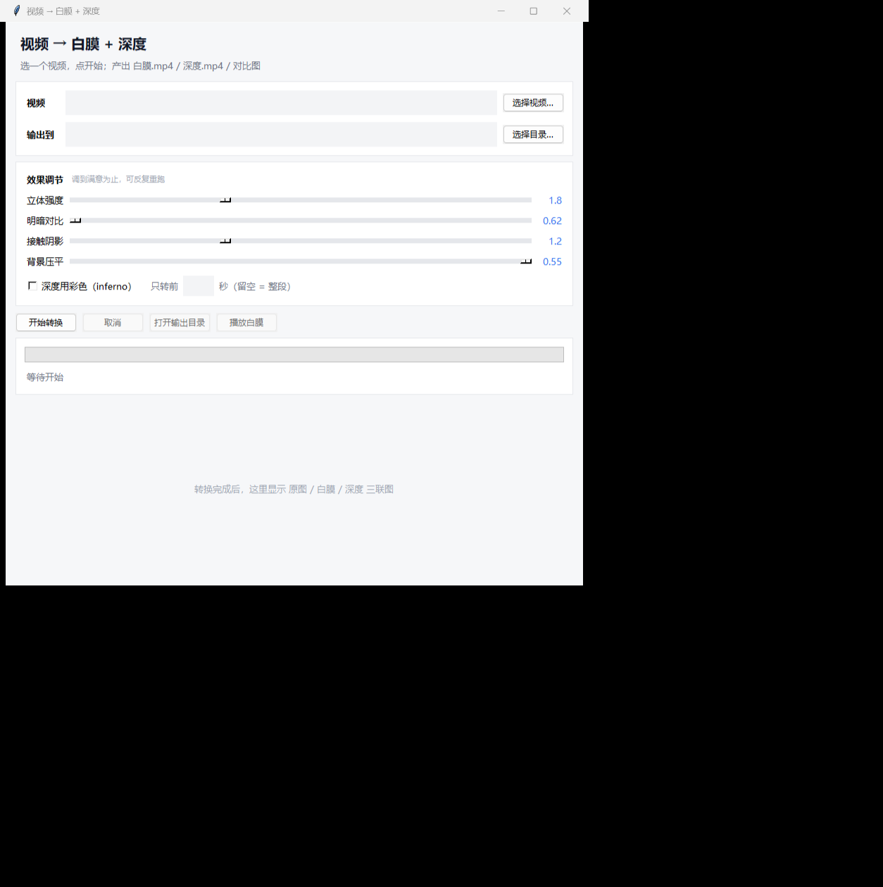

# 视频 → 白膜 + 深度

把**任意视频**转成 **白膜（clay render）** 和 **深度（depth）** 两种视频，外加一张三联对比图。

- **白膜**：像石膏／未上色模型一样的立体渲染，只保留形体、动作、明暗关系，丢掉颜色和贴图 —— 常用于动画预览、形体检查、风格化视频
- **深度**：用灰度（或彩色）表示远近，越近越亮 —— 可直接拿去做后期景深、位移贴图、伪 3D 等

纯本地运行，不联网、不上传，全部在本机显卡上算。




> 左：原始视频帧　中：深度图　右：白膜渲染

---

## 特性

- **一键出片**：拖一个视频上去，得到 `xxx_clay.mp4`、`xxx_depth.mp4`、`xxx_preview.png`
- **图形界面**：4 个滑块实时调效果（立体强度 / 明暗对比 / 接触阴影 / 背景压平），不用记参数
- **不依赖 CUDA**：用 DirectML（ONNX Runtime）跑深度，任何支持 DirectX 12 的显卡都能用 —— NVIDIA、AMD、Intel 核显皆可，没有可用显卡时自动退回 CPU
- **保留原音轨**：输出的视频带原来声音
- **时间稳定**：内置运动感知的时间滤波，静止镜头不闪烁，快速运动不拖影

## 系统要求

| 项目 | 要求 |
|---|---|
| 系统 | Windows 10 / 11 64 位（Linux / macOS 可跑命令行，但只能用 CPU） |
| 显卡 | 支持 DirectX 12 即可，显存 ≥ 2GB |
| Python | 3.10+（便携版已内置，无需安装） |
| 其它 | ffmpeg（便携版已内置） |

---

## 快速开始

### 方式一：直接用便携版（推荐给不想折腾的人）

从 [Releases](../../releases) 下载 `视频转白膜_便携版.zip`，解压后双击 **`启动白膜转换器.bat`** 即可。
包内已内置 Python、依赖、模型和 ffmpeg，约 1.7GB，不需要安装任何东西。

### 方式二：源码运行

```bash
git clone https://github.com/qwqwgogogo/video2clay.git
cd video2clay

pip install -r requirements.txt
# NVIDIA + CUDA 用户可换成：pip install onnxruntime-gpu
```

准备好两样东西：

1. **模型** `models/depth_anything_v2_large.onnx`
   - 从 [Releases](../../releases) 下载 `depth_anything_v2_large_756.onnx` 放进 `models/` 并改名；或
   - 自己导出，见下方「模型准备」
2. **ffmpeg**
   - 装了并在 PATH 里就能直接用；否则把 `ffmpeg.exe` 放到 `ffmpeg/` 或 `bin/` 子目录

然后：

```bash
python video2clay_gui.py          # 图形界面
python video2clay.py input.mp4    # 命令行
```

Windows 用户也可以双击 `run_gui.bat`，或把视频拖到 `convert_drag.bat` 上。

---

## 模型准备

深度模型用的是 [Depth Anything V2 Large](https://github.com/DepthAnything/Depth-Anything-V2)（1.28GB）。
仓库里不放权重，两种获取方式：

**A. 直接下载预编译 ONNX**

从 [Releases](../../releases) 页面下载 `depth_anything_v2_large_756.onnx`（1.25GB），放到 `models/` 目录。

**B. 自己从原模型导出**

```bash
pip install torch transformers onnx

# 1) 从 ModelScope 下原版权重（国内可达； huggingface 需要科学上网）
#    https://modelscope.cn/models/depth-anything/Depth-Anything-V2-Large-hf
#    下载整个仓库到本地，例如 D:\models\DA2-Large

# 2) 导出固定输入尺寸的 ONNX
python tools/export_onnx.py --model D:\models\DA2-Large --size 756 --out models/depth_anything_v2_large.onnx
```

导出的模型**输入尺寸是固定的**（这里是 756×756）。想要更高清晰度可以导出 1036，但 DirectML 上会慢 3 倍左右（0.44s/帧 → 1.40s/帧），实测白膜成片几乎看不出差别。

---

## 命令行用法

```bash
python video2clay.py input.mp4 [-o 输出目录] [各种参数]
```

| 参数 | 默认 | 说明 |
|---|---|---|
| `-o, --outdir` | 视频同目录 | 输出目录 |
| `--relief` | 1.8 | 立体强度（浮雕感）。太平就加大，太夸张就减小 |
| `--sigma` | 2.5 | 法线平滑半径，越大越柔和 |
| `--lo` / `--hi` | 0.62 / 1.0 | 白膜的明暗区间。`lo` 越大暗部越亮（越灰越平） |
| `--ao` | 1.2 | 接触阴影强度，0 = 关闭 |
| `--albedo` | 0.92 | 白膜整体亮度 |
| `--flatten-bg` | 0.55 | 背景压平强度，压制远处脏条纹 |
| `--gamma` | 0.95 | 输出 gamma |
| `--smooth` | 5 | 时间滤波窗口（帧）。1 = 关闭 |
| `--depth-mode` | gray | `gray` 灰度 / `color` 彩色（inferno） |
| `--fps` | 原视频 | 抽帧时重采样帧率，可用来降算力 |
| `--start` / `--duration` | - | 只处理某一段 |
| `--max-frames` | - | 最多处理多少帧（试效果用） |
| `--scale` | 1.0 | 先把画面缩小再处理，`0.5` = 半分辨率，快 4 倍 |
| `--keep-frames` | 关 | 保留中间抽出的 PNG 帧 |

例：先花 10 秒看效果

```bash
python video2clay.py myvideo.mp4 --max-frames 60 --scale 0.5
```

---

## 原理简述

1. **抽帧** —— ffmpeg 解码成 PNG 序列
2. **单目深度** —— Depth Anything V2 Large 逐帧推理，得到「近大远小」的视差图
3. **时间稳定** —— 对相邻帧做中值滤波抑制闪烁；检测到画面运动大时自动降低中值权重，避免拖影
4. **归一化** —— 全片用统一的 2% / 98% 分位数拉伸，保证帧间亮度一致、不闪
5. **伪法线** —— 由深度图求梯度得到法线（在 1/2 分辨率上算再上采样，抑制噪点）
6. **石膏光照** —— 把表面亮度锁死在 `[lo, hi]` 区间内做 Lambert + Blinn，配环境光遮蔽（AO）和背景压平，得到均匀的石膏质感而不是金属感
7. **编码** —— ffmpeg 编码 H.264 并保留原音轨

几个踩过的坑（写在这里省得后来人再踩）：

- 深度不连续处**不能**直接算环境光遮蔽，否则主体周围会出现一圈黑边 —— 必须用边缘掩码抑制
- 单目深度有噪点，直接乘以很大的浮雕系数会变成「麻点浮雕」—— 必须先滤波，并在低分辨率上求法线
- 时间中值滤波在快速运动处会产生「幽灵重影」—— 需要按运动量做软混合

---

## 性能参考

RTX 5070 Ti Laptop（DirectML，756 输入，768×768 素材）：

| 阶段 | 速度 |
|---|---|
| 深度推理 | ~2 帧/秒（0.44 s/帧） |
| 白膜渲染 | ~4 帧/秒 |
| 10 秒 24fps 素材 | 约 2.5 分钟 |

没有独显、退回 CPU 时会慢 5–10 倍，建议配合 `--scale 0.5 --max-frames 60` 先预览。

## 已知限制

- **单目深度是估计出来的**，不是真的几何。前景/背景颜色接近、纯色背景、雪地白墙这类画面，深度层次会不明显，白膜就会显得“平”
- 快速运动 + 大幅旋转的镜头，深度时序一致性会下降
- 细长结构（头发丝、铁丝、树枝）容易糊成一团
- 只输出视频；要出真正的 3D 网格（.obj/.glb）需要把逐帧深度三角化，属于另一套工具链

## 目录结构

```
video2clay.py          主流程（抽帧 → 深度 → 渲染 → 编码）
video2clay_gui.py      tkinter 图形界面
tools/
  export_onnx.py       从 HF/ModelScope 权重导出固定尺寸 ONNX
  bench_onnx.py        测 DirectML 推理速度
  verify_onnx.py       ONNX 与 torch 输出数值一致性校验
  to_fp16.py           fp16 转换（实测更慢，仅供参考）
  build_portable.ps1   打包便携版脚本
run_gui.bat            启动图形界面
convert_drag.bat       拖拽转换
docs/                  截图
models/                放 ONNX 模型（不进仓库）
```

## 致谢

- [Depth Anything V2](https://github.com/DepthAnything/Depth-Anything-V2) —— 深度估计模型
- [ONNX Runtime](https://github.com/microsoft/onnxruntime) + DirectML —— 跨显卡推理
- [ffmpeg](https://ffmpeg.org/) —— 解码与编码

## License

[MIT](LICENSE)

模型权重遵循 Depth Anything V2 原项目的许可（Apache-2.0 / CC-BY-NC-4.0，见其仓库说明），本仓库只提供代码。